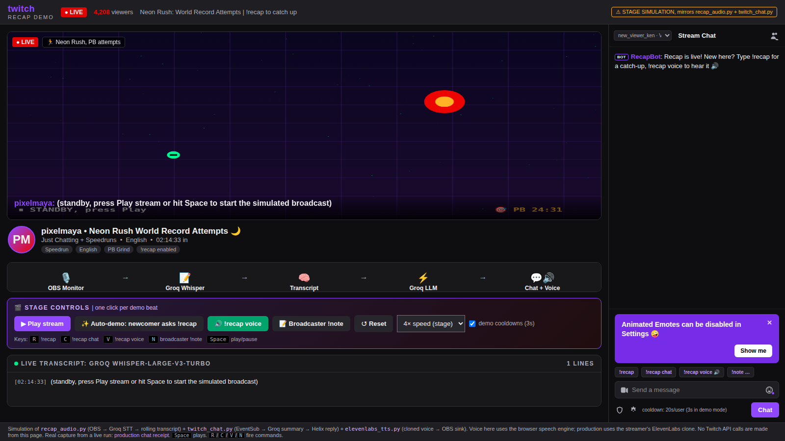
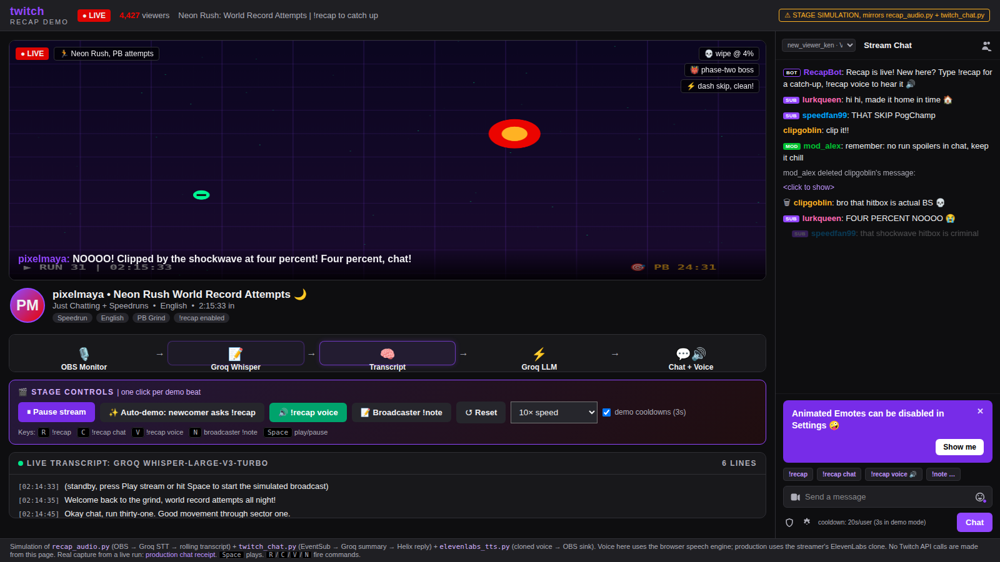
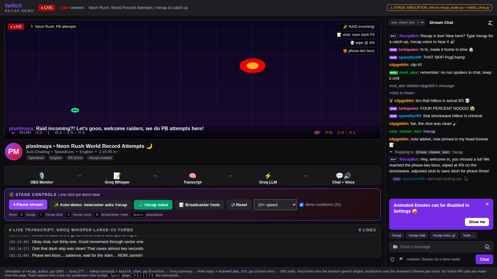
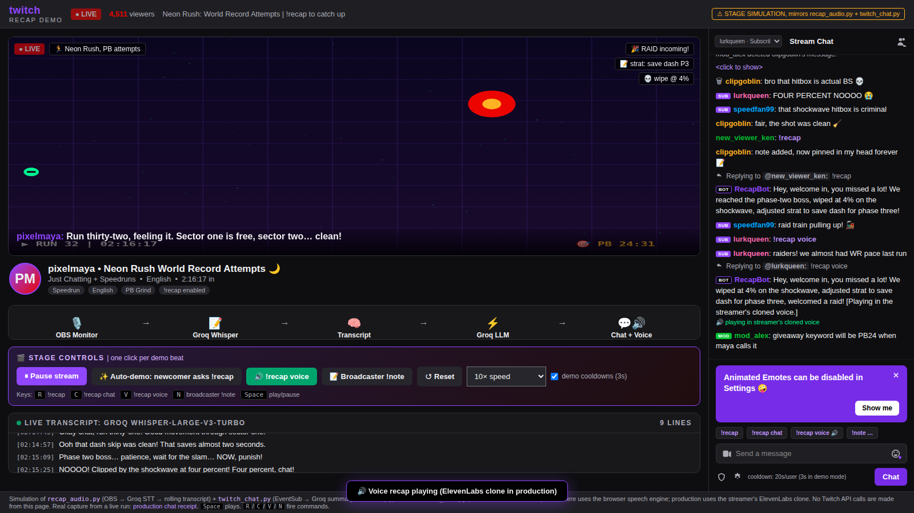
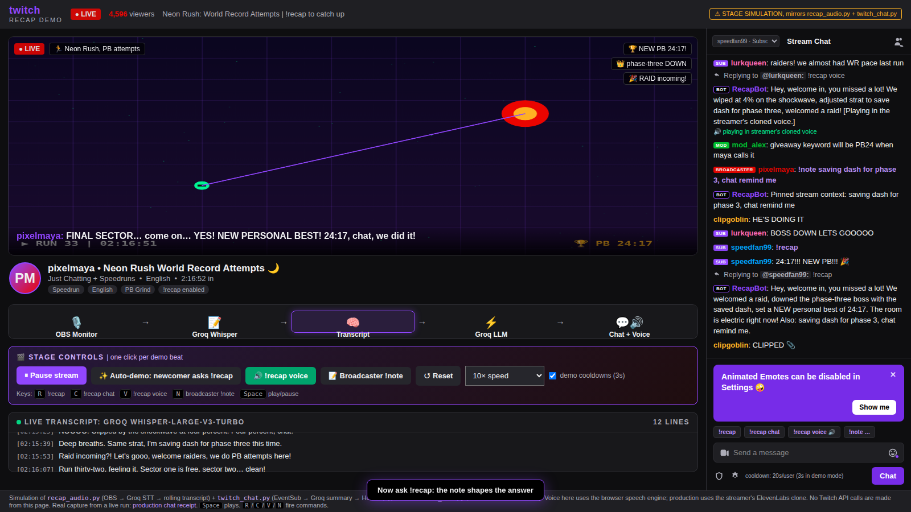
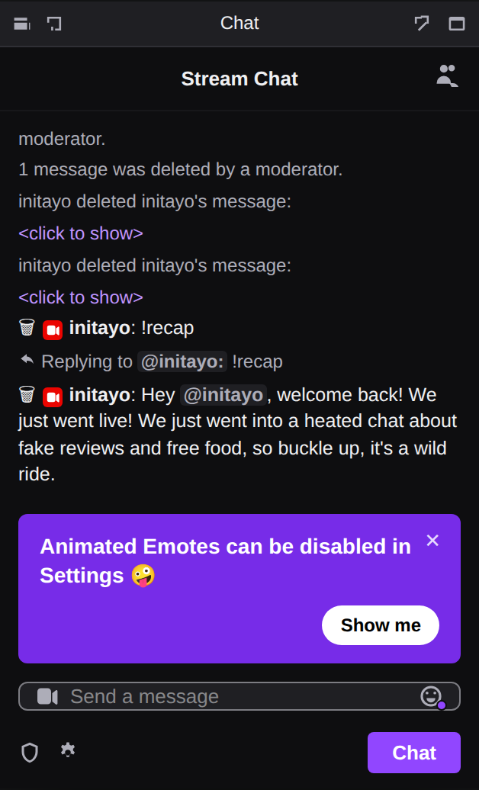

# Recap — never miss the stream again


> Built for the TwitchCon hackathon. **Recap** is a live catch-up bot for Twitch: it listens to the stream through OBS, transcribes speech in rolling 10-second chunks with Groq's `whisper-large-v3-turbo`, and keeps a 5-minute rolling transcript in memory. When a newcomer types `!recap`, Recap writes a warm 1–3 sentence catch-up from the real transcript and posts it straight into chat — or speaks it aloud in the streamer's own cloned ElevenLabs voice.

Demo video: `recap-demo-video/recap-demo.mp4` — upload it to YouTube (public) and paste the link here.

## How to use it

### 1. Install

```bash
sudo apt update
sudo apt install ffmpeg pulseaudio-utils
python3 -m venv .venv
. .venv/bin/activate
pip install -r requirements.txt
```

Requirements: Ubuntu 22.04 with OBS using PulseAudio (or a PipeWire-compatible setup), `ffmpeg`, `pulseaudio-utils`, Python 3.10+. Twitch credentials are only needed for `--twitch`.

### 2. Configure credentials

Fill in the local `.env` file (see `.env.example`). `.env` is gitignored — never commit it. Values already exported in the shell take precedence.

```
GROQ_API_KEY=
GROQ_CHAT_MODEL=openai/gpt-oss-120b

TWITCH_CLIENT_ID=
TWITCH_ACCESS_TOKEN=   # broadcaster token: twitch token -u -s 'user:read:chat user:write:chat'
TWITCH_CHANNEL=        # channel login name, without '#'

ELEVENLABS_API_KEY=
ELEVENLABS_VOICE_ID=   # optional: cloned voice; blank = auto-selected stock voice
ELEVENLABS_MODEL_ID=eleven_turbo_v2_5
```

### 3. Route OBS audio into Recap

Create the virtual sinks (repeat after every audio-server restart):

```bash
pactl load-module module-null-sink sink_name=recap sink_properties=device.description=RecapCapture
pactl load-module module-null-sink sink_name=recap_tts sink_properties=device.description=RecapTTS
```

- In OBS, open **Settings → Audio → Advanced → Monitoring Device** and choose `RecapCapture`. In **Advanced Audio Properties**, enable monitoring only for the sources the streamer wants transcribed.
- For voice recaps, add an **Audio Input Capture** source on `Monitor of RecapTTS`. Keep its monitoring off: speech should reach the stream output, not the `RecapCapture` monitor that Recap transcribes.
- Check sources with `python recap_audio.py --list-sources` (expect `recap.monitor`).

### 4. Run

```bash
# transcribe only, recap in the terminal
python recap_audio.py --source recap.monitor

# full setup: Twitch chat + cloned-voice recaps
python recap_audio.py --source recap.monitor --twitch --speak
```

The default chunk is 10 seconds with a 1 second overlap; text appears with a short delay. Ctrl+C stops capture. Transcript is kept in memory only and disappears when the process exits. Tune with `--window-minutes 3`, `--chunk-seconds`, `--overlap-seconds`, `--tts-out-dir`, `--no-play` (save MP3s without playing). One-off voice tools: `--list-voices`, `--clone-voice MyVoice sample1.mp3 [sample2.mp3 ...]`.

### 5. Chat commands

| Who | Command | What happens |
|---|---|---|
| Anyone (terminal) | `!recap` | Prints a 2–4 sentence recap of the last 5 minutes |
| Anyone (terminal) | `!recap voice` | Same, plus speaks it in the ElevenLabs voice |
| Viewers | `!recap` / `!recap stream` | Stream-summary reply in chat |
| Viewers | `!recap chat` | Reply summarizing recent chat instead |
| Viewers | `!recap voice` (+ `stream`/`chat` variants) | Text reply + cloned-voice audio on stream |
| Broadcaster | `!note <context>` | Pins trusted context that informs stream recaps |
| Broadcaster | `!voice <text>` | Speaks any text (handy for testing the voice) |

Viewers have a 20-second per-user recap cooldown; voice recaps share an extra 30-second global throttle to cap TTS cost.

## Screenshots

| Standby | Stream live |
|---|---|
|  |  |

| Text recap reply | Voice recap |
|---|---|
|  |  |

| Note-informed recap | Production chat |
|---|---|
|  |  |

## Current boundary

This prototype does not persist notes or transcripts between runs, or provide a dashboard/OAuth web flow. Twitch credentials are environment variables and must be refreshed when expired. Voice cloning reuses ElevenLabs' hosted API (uploaded samples are subject to their data handling; Instant Voice Cloning needs a paid plan — without a voice ID, Recap falls back to a stock voice). Verify the selected OBS sources and Groq data handling before using it on a live stream.

## License

MIT — see [LICENSE](LICENSE).
